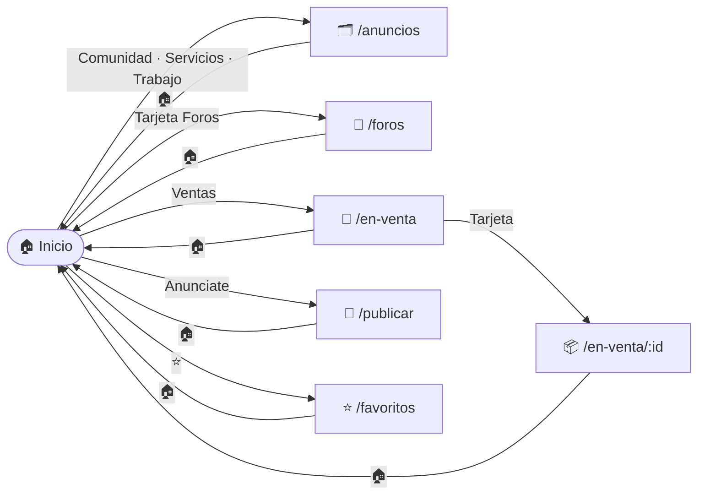
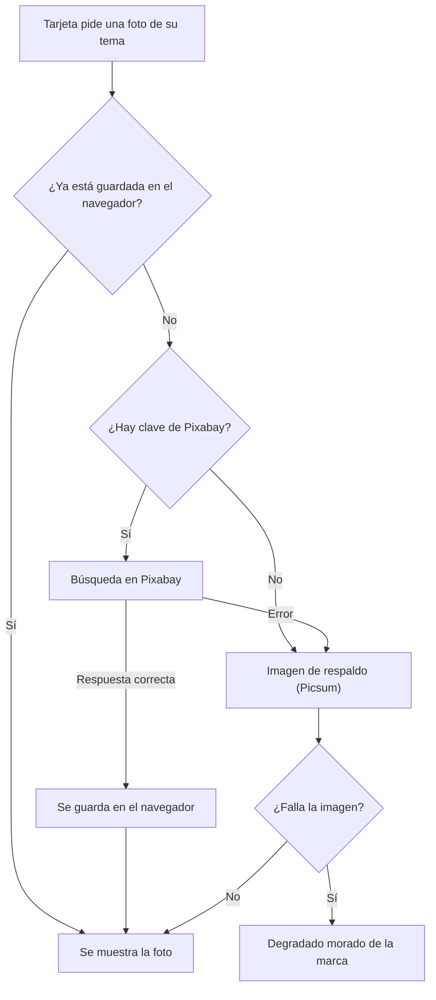

<div align="center">

# ☮️ Craigslist · Rediseño Colombia

**Un rediseño visual y moderno de [craigslist.org/area/colombia](https://www.craigslist.org/area/colombia), hecho con React.**


</div>

---

## 📖 Sobre el proyecto

La página de Craigslist para Colombia es funcional pero visualmente muy austera: texto, enlaces y casi nada de imágenes. Este proyecto la **rediseña por completo**: partimos de maquetas en Figma y las convertimos en una interfaz limpia, con tarjetas con fotos, carruseles, modo oscuro, mapa de ubicación y pantallas completas para cada sección.

> Es un proyecto académico de rediseño. Todo el contenido de anuncios, foros y productos es de ejemplo (*lorem ipsum*) y no hay conexión con los servidores reales de Craigslist.

### Antes y después

| | Craigslist original | Este rediseño |
|---|---|---|
| **Estilo** | Listas de enlaces en texto plano | Tarjetas con imagen, color de marca y bordes suaves |
| **Navegación** | Enlaces por categoría | Carruseles deslizables, barra lateral y menús desplegables |
| **Imágenes** | Prácticamente ninguna | Fotos por tema traídas desde una API de imágenes |
| **Tema** | Sin opción de cambiar de tema | Claro y oscuro, con el botón junto al buscador |
| **Ubicación** | Nombre del área en texto, sin mapa | Ventana con mapa para elegir la ubicación |
| **Pantallas** | Páginas de listas de enlaces | Inicio, anuncios, en venta, detalle, foros, favoritos y publicar |
| **Calendario** | Cuadrícula de fechas con enlaces | Calendario de eventos con días seleccionables |
| **Adaptabilidad** | — | Diseño que se ajusta a celular, tablet y escritorio |

---

## 👩‍💻 Equipo

Proyecto realizado en conjunto por dos personas, con roles complementarios:

| | Integrante | Aporte |
|---|---|---|
| 🎨 | **Katherine Guayazan** | **Parte visual:** diseño de la interfaz, maquetas, paleta de color y estilo |
| ⚙️ | **Paula Castro** | **Core:** arquitectura en React, rutas, componentes, lógica, integración con la API de imágenes y despliegue |

---

## ✨ Funcionalidades

| Sección | Qué incluye |
|---|---|
| 🏠 **Inicio** | Cuatro carruseles (Comunidad, Ventas, Servicios, Trabajo) con 8 tarjetas cada uno, buscador de categorías y calendario de eventos con días seleccionables |
| 🌗 **Modo oscuro** | Botón junto al buscador; la preferencia se guarda en el navegador |
| 📍 **Ubicación** | Ventana modal con mapa embebido para elegir dónde buscar |
| ❓ **Ayuda / Q&A** | Menú desplegable con enlaces de ayuda y seguridad |
| 📝 **Publica tu anuncio** | Formulario por secciones: información básica, detalles, contacto y ubicación exacta, con pantalla de confirmación |
| 🗂️ **Anuncios** | Listado con filtros, conteos, vistas Grid / List / Map, favoritos por anuncio y paginación |
| 🛒 **En venta** | Cuadrícula de productos con filtros (vendedor, distancia, precio, idioma) |
| 📦 **Detalle de producto** | Galería con miniaturas, ficha técnica, descripción y acciones (responder, compartir, imprimir…) |
| 💬 **Foros** | Deslizador de foros, hilos con respuestas desplegables, votos y caja para nuevo hilo |
| ⭐ **Favoritos** | Pantalla con filtros, búsqueda y estado vacío |
| 🔗 **Craigslist found** | Enlace al sitio [craigslistfund.org](https://www.craigslistfund.org) |

---

## 🧭 Mapa de navegación

| Ruta | Pantalla | Cómo se llega |
|---|---|---|
| `/` | Inicio | Logo o ícono de la casa |
| `/anuncios` | Listado de anuncios | Títulos y tarjetas de Comunidad, Servicios y Trabajo |
| `/foros` | Foros | Tarjeta **Foros** de Comunidad |
| `/en-venta` | Cuadrícula En venta | Título y tarjetas de Ventas |
| `/en-venta/:saleId` | Detalle de producto | Tarjeta de un producto |
| `/favoritos` | Favoritos | Ícono de la estrella |
| `/publicar` | Publica tu anuncio | Botón **Anunciate** |
| `*` | Página no encontrada | Cualquier ruta inexistente |



---

## 🛠️ Tecnologías

| Tecnología | Versión | Para qué se usa |
|---|---|---|
| [React](https://react.dev) | 19 | Interfaz basada en componentes |
| [Vite](https://vite.dev) | 8 | Servidor de desarrollo y empaquetado |
| [Tailwind CSS](https://tailwindcss.com) | 4 | Estilos con variables de diseño y modo oscuro |
| [React Router](https://reactrouter.com) | 7 | Navegación entre pantallas |
| [Lucide React](https://lucide.dev) | 1 | Íconos |
| [Pixabay API](https://pixabay.com/api/docs/) | — | Fotos relacionadas con cada tema (opcional) |
| [Picsum Photos](https://picsum.photos) | — | Imágenes de respaldo |
| [Vercel](https://vercel.com) | — | Despliegue |

---

## 🗺️ Cómo está organizado

```text
src/
├── components/        Piezas reutilizables, agrupadas por pantalla
│   ├── favorites/     Barra lateral y filtros de Favoritos
│   ├── form/          Campos y secciones genéricas de formularios
│   ├── forum/         Comentarios, respuestas, votos y deslizador de foros
│   ├── listings/      Filtros, filas, paginación y barra de herramientas
│   ├── publish/       Secciones del formulario Publica tu anuncio
│   └── sales/         Tarjetas, galería, ficha y filtros de En venta
├── data/              Contenido de ejemplo (categorías, foros, ventas…)
├── hooks/             Lógica reutilizable (modo oscuro, imágenes, scroll…)
├── pages/             Una pantalla por ruta
├── utils/             Funciones auxiliares (imágenes, mapas, texto)
├── App.jsx            Definición de rutas
├── main.jsx           Punto de entrada
└── index.css          Colores de marca y configuración de Tailwind
```

### Componentes y hooks principales

| Pieza | Responsabilidad |
|---|---|
| `Layout` | Cabecera, pie de página y buscador compartidos por todas las rutas |
| `Carousel` + `CategoryCard` | Carrusel con flechas y tarjetas con imagen por tema |
| `RemoteImage` | Imagen con degradado de respaldo si la carga falla |
| `useDarkMode` | Alterna y recuerda el tema claro u oscuro |
| `useScrollEdges` | Deslizadores con flechas que se desactivan en los extremos |
| `useTopicImages` / `useSaleImages` | Piden fotos por tema y usan respaldo si no hay respuesta |
| `useLocationModal` | Abre y confirma la ventana del mapa |

### Cómo se cargan las imágenes



---

## 🎨 Sistema de diseño

Los colores viven como variables CSS en `src/index.css` y se enlazan a Tailwind, de modo que cambiar de tema solo reemplaza los valores.

| Token | Claro | Oscuro | Uso |
|---|---|---|---|
| `brand` | `#7b2d9b` | `#c58df0` | Color de marca, enlaces y acentos |
| `bar` | `#d9c9e6` | `#2b2036` | Cabecera y pie de página |
| `page` | `#ebebeb` | `#151317` | Fondo de la página |
| `sidebar` | `#dedede` | `#1d1a20` | Barras laterales |
| `chip` | `#e0e0e0` | `#2a262e` | Chips y encabezados de sección |
| `card-label` | `#d9c9e6` | `#3a2b48` | Etiqueta de las tarjetas |
| `field` | `#ffffff` | `#2b2730` | Campos de texto |
| `ink` | `#2b2b2b` | `#ececec` | Texto principal |
| `ink-soft` | `#5c5c5c` | `#b4b0b8` | Texto secundario |

---

## 🚀 Cómo ejecutarlo

### Requisitos

- [Node.js](https://nodejs.org) en una versión reciente (20.19 o superior)
- npm

### Pasos

```bash
git clone <URL-DEL-REPOSITORIO>
cd craigslist-app
npm install
npm run dev
```

Abre la dirección que muestra la terminal (normalmente `http://localhost:5173`).

### Scripts disponibles

| Comando | Qué hace |
|---|---|
| `npm run dev` | Inicia el servidor de desarrollo |
| `npm run build` | Genera la versión de producción en `dist/` |
| `npm run preview` | Sirve localmente la versión de producción |

### 🖼️ Fotos por tema (opcional)

Sin configurar nada, el proyecto funciona con imágenes de respaldo. Para que cada tarjeta muestre fotos relacionadas con su tema:

1. Crea una cuenta gratis en [pixabay.com](https://pixabay.com) y copia tu clave en [pixabay.com/api/docs](https://pixabay.com/api/docs/).
2. Crea un archivo `.env.local` en la raíz del proyecto:

   ```bash
   VITE_PIXABAY_API_KEY=tu_clave
   ```

3. Reinicia `npm run dev`.

> La clave se incluye en el código que recibe el navegador, así que conviene usar una clave gratuita y no una de uso privado. El archivo `.env.local` no se sube a GitHub.

---

## ☁️ Despliegue en Vercel

1. Sube el repositorio a GitHub e impórtalo en [Vercel](https://vercel.com).
2. Vercel detecta Vite automáticamente (comando `npm run build`, carpeta `dist`).
3. En **Settings → Environment Variables** agrega `VITE_PIXABAY_API_KEY` y marca los entornos donde la quieras (Production, Preview, Development).
4. Haz un **Redeploy** sin caché: las variables `VITE_` se incorporan al momento de compilar, así que un despliegue anterior no las tiene.

El archivo `vercel.json` redirige todas las rutas a `index.html` para que enlaces como `/foros` o `/en-venta/3` funcionen al recargar la página.

---

## 🧩 Decisiones de diseño y código

| Decisión | Motivo |
|---|---|
| Componentes pequeños, una responsabilidad cada uno | Código legible y fácil de mantener |
| Contenido de ejemplo separado en `src/data/` | Cambiar textos o categorías sin tocar la interfaz |
| Sin comentarios en el código | Nombres claros en lugar de explicaciones al margen |
| Colores como variables CSS | Modo oscuro sin duplicar estilos |
| Respaldo en cada nivel de imágenes | La página nunca se ve rota si una API falla |
| Pantallas solo de interfaz | El rediseño es visual: no hay cuentas, base de datos ni envío real de anuncios |

---

## ⚠️ Aviso

Este es un proyecto académico de rediseño. **No está afiliado, patrocinado ni respaldado por Craigslist.** El nombre y la inspiración visual pertenecen a sus propietarios.

---

<div align="center">

Hecho con 💜 por **Katherine Guayazan** (diseño visual) y **Paula Castro** (core)

</div>
